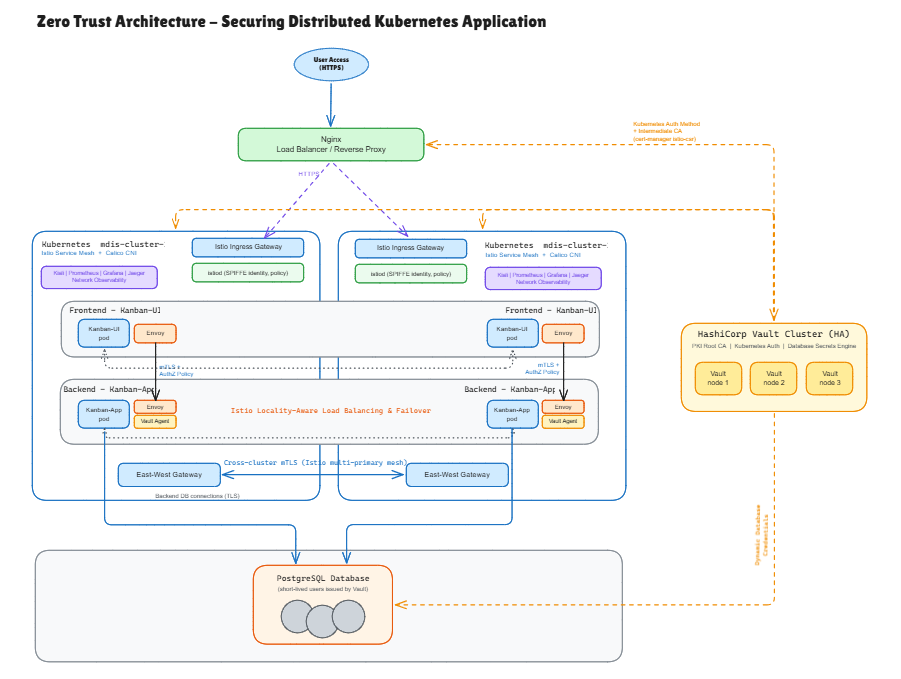

# Zero Trust Multi-Cluster Kubernetes: Istio Service Mesh with HashiCorp Vault

This is the artefact for the project *Investigation into Zero Trust Networking for Securing Distributed Kubernetes Applications*.
It builds the full architecture on one Linux machine. Everything runs in Docker:
- two KinD clusters
- a 3-node Vault cluster
- an Nginx load balancer
- PostgreSQL



> Open `docs/Teesside-Computing-Project.excalidraw` at excalidraw.com to edit the diagram. Export it as `docs/Architecture-Diagram.png` to show it above.

## Repository layout

```
zt-istio-lab/
├── lab.env              Shared settings (versions, CIDRs, IPs). Used by both build paths.
├── resources/           All config files. Single source of truth.
│   ├── app/             Kanban app (FastAPI backend + Nginx frontend)
│   ├── kind/            KinD cluster template
│   ├── calico/          Calico render helper
│   ├── metallb/         MetalLB address pool
│   ├── certs/           SAN definitions for the lab infrastructure certificates
│   ├── postgres/        pg_hba.conf (TLS only) and database init script
│   ├── vault/           Vault server config, policies, DB role SQL
│   ├── nginx/           Load balancer configs (stage 1: Vault only; stage 2: + app front door)
│   ├── cert-manager/    Vault ClusterIssuer and istio-csr values
│   ├── istio/           istiod values, STRICT mTLS, tracing
│   └── k8s/             Vault auth SA, Kanban namespace, app, ingress, security policies
├── automated/           One-command build: run-all.sh, steps 00–12, cleanup
├── manual/              Step-by-step guides. Build each component by hand.
└── docs/                Architecture diagram
```

Both `automated/` and `manual/` read the same `resources/` files. To change something (for example a policy), edit it once in `resources/`. Files ending in `.tmpl` have `${VARIABLE}` placeholders, which are filled from `lab.env` with `envsubst`.

Generated files go to `.work/` and are never committed: certificates, Vault keys, passwords and rendered configs.

## Two ways to build

### Automated

```bash
./automated/run-all.sh                               # about 15–25 min on the first run
echo "127.0.0.1  kanban.lab" | sudo tee -a /etc/hosts
./automated/12-tests.sh                              # Zero Trust tests with PASS/FAIL
```

Each step is safe to re-run. If one fails, fix the cause and run that step again.

### Manual

Start at [manual/README.md](manual/README.md) and follow guides 00 to 12. Every command is shown and explained, with a **Check** at the end of each step.

You can mix the two paths. For example, run `automated/01-clusters.sh` to get the clusters, then build Vault by hand with `manual/04-vault-cluster.md`.

## Component map

| Diagram component | Built by | Config in |
|---|---|---|
| User Access (HTTPS) | Browser or `curl` → `https://kanban.lab` | – |
| Nginx Load Balancer / Reverse Proxy | step 04 (Vault), step 11 (app) | `resources/nginx/` |
| HashiCorp Vault Cluster (HA) | step 04 | `resources/vault/vault.hcl.tmpl` |
| PKI Root CA, Kubernetes Auth, DB Secrets Engine | step 05 | `resources/vault/`, `resources/k8s/vault-auth.yaml` |
| Intermediate CA via cert-manager istio-csr | step 06 | `resources/cert-manager/` |
| mdis-cluster-1 / mdis-cluster-2 (KinD + Calico CNI) | step 01 | `resources/kind/`, `resources/calico/`, `resources/metallb/` |
| Istio Ingress Gateway, istiod, East-West Gateway | step 07 | `resources/istio/` |
| Kiali, Prometheus, Grafana, Jaeger | step 08 | `resources/istio/telemetry.yaml` |
| Kanban-UI and Kanban-App pods, Envoy, Vault Agent | step 09 | `resources/app/`, `resources/k8s/app.yaml.tmpl` |
| Locality-aware load balancing and failover | step 09 | `DestinationRule` in `resources/k8s/app.yaml.tmpl` |
| mTLS + AuthZ policy, NetworkPolicy | steps 07 and 10 | `resources/istio/peer-authentication.yaml`, `resources/k8s/security.yaml.tmpl` |
| PostgreSQL (TLS only, short-lived users) | steps 03 and 05 | `resources/postgres/`, `resources/vault/db-role-creation.sql` |

## Requirements

- Linux with Docker, kind, kubectl, helm, jq, openssl, envsubst (`gettext`) and curl
- 8+ CPU cores, 16 GB RAM or more (32 GB recommended), about 30 GB of disk
- Raised inotify limits (see `manual/00-prerequisites.md`)
- Free ports 443, 80 and 8443. To use other ports, set `HTTPS_PORT` and `HTTP_PORT` before you start.

## After a reboot

The containers and clusters come back on their own, but Vault starts sealed. Run:

```bash
./automated/04-vault.sh
```

## Clean up

```bash
./automated/99-cleanup.sh          # clusters, containers and volumes
./automated/99-cleanup.sh --all    # also delete .work/
```

## Lab limitations (state these in the report)

- **Vault keys.** Vault uses 1 unseal key and a stored root token. Production would use Shamir 5/3 or auto-unseal, and would revoke the root token.
- **File permissions.** The lab CA private keys can be read by any local user. Vault runs with `disable_mlock`.
- **Certificate approval.** cert-manager approves every certificate request automatically. Production would add cert-manager approver-policy.
- **Single host.** Each cluster has one node and both run on one host. Zones are simulated with labels, so performance numbers are only valid as relative comparisons.
- **Kiali.** It shows one cluster at a time unless you add remote cluster secrets for Kiali.

## Troubleshooting

| Problem | Where to look |
|---|---|
| Pods stuck in `ContainerCreating` | inotify limits and free RAM; `kubectl -n kube-system get pods` |
| `ClusterIssuer` not Ready | `kubectl describe clusterissuer vault-issuer`; usually Vault is sealed |
| istiod fails, `istiod-tls` missing | `kubectl -n cert-manager logs deploy/cert-manager-istio-csr`, then re-run steps 06 and 07 |
| Backend returns 503 "database unavailable" | `kubectl -n kanban logs deploy/kanban-app -c vault-agent-init` |
| Cross-cluster calls fail | `istioctl remote-clusters`; both east-west gateways need an external IP |
